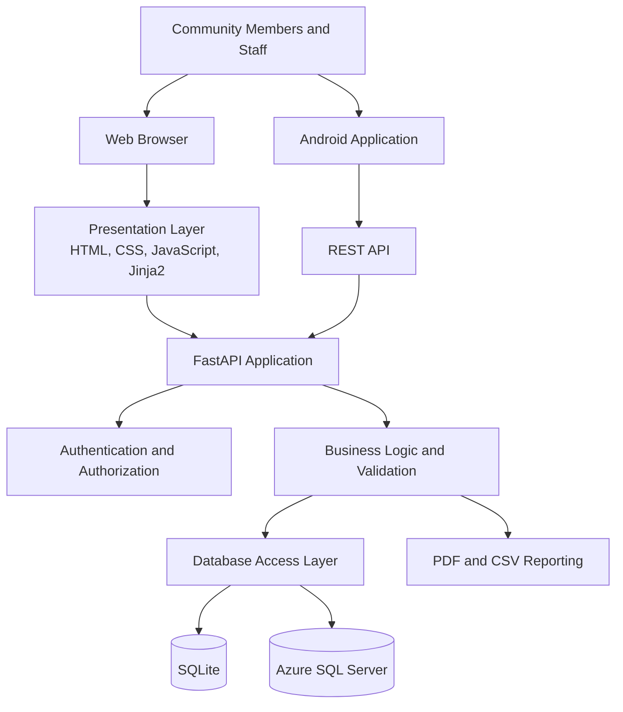

# 🌍 Aurorah CAN Digital Hub

## 📖 Table of Contents

- [🌟 Project Overview](#-project-overview)
- [🎯 The Problem We Are Solving](#-the-problem-we-are-solving)
- [✨ Key Features](#-key-features)
- [👥 User Roles](#-user-roles)
- [🏗️ System Architecture](#️-system-architecture)
- [🛠️ Technology Stack](#️-technology-stack)
- [🔐 Security and Privacy](#-security-and-privacy)
- [🗄️ Database Design](#️-database-design)
- [🔌 REST API Reference](#-rest-api-reference)
- [📊 Administration and Reporting](#-administration-and-reporting)
- [📁 Project Structure](#-project-structure)
- [⚙️ Installation and Setup](#️-installation-and-setup)
- [🗃️ Azure SQL Server Configuration](#️-azure-sql-server-configuration)
- [👤 Staff Account Management](#-staff-account-management)
- [🧪 Testing and Development](#-testing-and-development)
- [🚀 Deployment Considerations](#-deployment-considerations)
- [🗺️ Project Roadmap](#️-project-roadmap)
- [🤝 Contributing](#-contributing)
- [📄 License and Acknowledgements](#-license-and-acknowledgements)

---

## 🌟 Project Overview

**Aurorah CAN Digital Hub** is a community-focused web platform developed for the Aurorah Kuils River Community Action Network (CAN), a community-driven initiative supporting vulnerable individuals and households in Kuils River, Cape Town, South Africa.

The organisation provides community assistance through food relief, resource redistribution, volunteer mobilisation, and donations. As these activities grow, managing information through disconnected social media posts, messaging conversations, and spreadsheets becomes increasingly difficult.

The Digital Hub addresses this challenge by bringing essential community operations into one centralised system.

The platform provides a public-facing website, a secure administrative workspace, a relational data layer, and a REST API that supports integration with an Android mobile application.

### Our mission

> To make community support easier to coordinate, safer to manage, and more transparent to the people who make it possible.

### Project at a glance

| Area             | Description                                      |
| ---------------- | ------------------------------------------------ |
| Project          | Aurorah CAN Digital Hub                          |
| Organisation     | Aurorah Kuils River Community Action Network     |
| Primary users    | Beneficiaries, volunteers, donors, and staff     |
| Backend          | Python and FastAPI                               |
| Frontend         | HTML, CSS, JavaScript, and Jinja2                |
| Data storage     | SQLite by default, with Azure SQL Server support |
| API              | RESTful JSON endpoints                           |
| Reporting        | PDF reports and CSV exports                      |
| Geographic focus | Kuils River, Cape Town, South Africa             |

---

## 🎯 The Problem We Are Solving

Aurorah CAN's community work has traditionally relied on tools such as Facebook, WhatsApp, and Google Forms. Although useful for coordinating local support, these tools do not provide a single, structured place to manage the organisation's growing operational needs.

The project addresses five interconnected challenges.

- **Fragmented information:** Volunteer details, assistance requests, donations, and community needs can become scattered across different platforms.
- **Administrative workload:** Manual data collection and record management consume time that could otherwise support the community.
- **Disconnected resources:** Coordinators need better visibility into available volunteers, outstanding needs, and potential sources of assistance.
- **Financial accountability:** Donation records need clear statuses, traceable allocations, and appropriate verification.
- **Limited operational visibility:** Staff need reliable summaries and reports to understand activity, identify outstanding work, and support informed decisions.

The Digital Hub provides a shared operational foundation for these activities, with structured data, access-controlled administration, and public-facing information.

## ✨ Key Features

### 🌐 1. Public Community Website

The public website gives community members a central place to discover Aurorah CAN, request assistance, volunteer, make donation pledges, and read community updates.

- Responsive layouts for desktop and mobile browsers.
- About page describing the organisation and its mission.
- Dedicated assistance request and volunteer registration pages.
- Donation and in-kind contribution forms.
- News feed with individual article pages.
- Form validation and accessible feedback.
- Keyboard-operable navigation and reduced-motion support.

### 🤲 2. Assistance Request Management

Community members can submit requests for support through a structured process.

- Registered user accounts for assistance submissions.
- Categorised requests with descriptions, locations, contact details, and urgency levels.
- Private beneficiary records rather than unrestricted public access to submitted details.
- Staff-controlled review, assignment, and status management.
- Internal notes, follow-up dates, and case history.
- Recorded reasons for rejecting or closing requests.
- Archiving to preserve historical records.

### 🙋 3. Volunteer Coordination

The platform captures volunteer information in a structured format, allowing staff to review and coordinate community participation.

- Volunteer registration and onboarding.
- Skills, location, contact details, and availability.
- Filtering by relevant volunteer attributes.
- Assignment scheduling.
- Upcoming-work visibility.
- Community-needs assistance offers through the mobile API.
- Administrative review of volunteer records and activities.

### 💚 4. Donation and Resource Management

The donation workflow supports monetary pledges and in-kind contributions.

- Monetary pledge submissions.
- In-kind donation details, including item categories and descriptions.
- Optional collection or drop-off preferences.
- Targeted funding categories and community-need allocations.
- Donation verification and status tracking.
- Financial reconciliation exports for authorised staff.
- Optional requests for donation documentation.

**Important:** The application does not currently process online payments. Monetary submissions are recorded as pledges and must be verified by staff. The donation workflow does not charge a payment method or independently confirm that money has been received.

Requested tax certificates are currently provided as clearly marked demonstration documents, not valid proof of payment or tax-deductible receipts. A certificate must not be treated as valid merely because a request was submitted.

### 📰 5. Community News and Announcements

The news module allows authorised staff to manage public communications.

- Create and manage news articles.
- Prepare content as drafts.
- Preview articles before publication.
- Publish approved content.
- Archive older articles.
- Display published articles through the public news feed.
- Associate articles with supplied images and publication dates.

Only published content is intended to appear on the public-facing news pages.

### 📊 6. Administrative Dashboard

The staff workspace brings day-to-day operational activities into a single interface.

- Overview of operational activity.
- Reporting-period selection and date filters.
- Volunteer, donation, beneficiary, and community-needs management.
- Priority queues for urgent assistance and outstanding tasks.
- Search and filtering for operational records.
- Staff account and role management.
- Audit-event review.
- CSV exports and PDF reporting.
- A responsive sidebar and mobile navigation.
- Persistent reporting filters that can be bookmarked or shared.

Dashboard data is derived from the selected reporting period. Empty reporting windows display explanatory states instead of misleading placeholder charts.

### 📱 7. Android Integration

The backend provides a JSON REST API that supports the Android application without requiring the mobile client to connect directly to the database.

The API supports:

- User registration and sign-in.
- Firebase-backed Google sign-in.
- Profile and password management.
- Published news retrieval.
- Public community-needs retrieval.
- Assistance request submission.
- Volunteer assistance offers.
- Monetary pledge and in-kind donation submissions.

The mobile application and website use the same configured backend data source.

### 📄 8. Reporting and Data Exports

The platform provides reporting capabilities for operational oversight.

| Report or export       | Purpose                                                       |
| ---------------------- | ------------------------------------------------------------- |
| Volunteer activity     | Review volunteer records, skills, and availability            |
| Donation summary       | Review donation records, types, dates, and financial statuses |
| Beneficiary assistance | Review assistance cases and related operational information   |
| Community needs        | Review open needs, priorities, and status changes             |
| Operational dashboard  | Summarise activity over a selected reporting period           |
| CSV reconciliation     | Support authorised financial record reconciliation            |
| PDF documents          | Generate supported reports and document outputs               |

Available report fields and output formats depend on the relevant workspace permissions and implementation.

---

## 👥 User Roles

The platform distinguishes public website accounts from internal staff accounts. These account types serve different purposes and do not share the same permissions.

### Public users

| User type                   | Primary responsibilities                                                    |
| --------------------------- | --------------------------------------------------------------------------- |
| Visitor                     | Browse public pages, read news, and make permitted guest donation pledges   |
| Registered community member | Manage their account and submit assistance requests                         |
| Volunteer                   | Register, provide skills and availability information, and offer assistance |
| Donor                       | Submit monetary pledges or in-kind donation offers                          |

### Internal staff

Staff accounts are provisioned by an operator rather than through public registration.

| Staff role     | Access scope                                                                   |
| -------------- | ------------------------------------------------------------------------------ |
| Administrator  | Operational workspaces, staff management, and audit records                    |
| Case Worker    | Beneficiary requests, community needs, and volunteer scheduling                |
| Finance        | Donation verification, allocations, financial summaries, and permitted reports |
| Content Editor | News and announcements                                                         |
| Read-Only      | Aggregated operational summaries without individual-record editing             |

Permissions are enforced on the server for dashboard data, mutations, and exports. The Read-Only role uses aggregated data rather than returning individual beneficiary contact details or individual donation and volunteer records.

---

## 🏗️ System Architecture

The system follows a three-layer architecture, separating the user interface, application logic, and data persistence.



### Presentation layer

The presentation layer provides the public website and internal administrative interface.

It is responsible for displaying pages, collecting form inputs, presenting validation feedback, and allowing users to interact with the system.

**Technologies:** HTML, CSS, JavaScript, Jinja2 templates.

### Application layer

The application layer processes requests and applies business rules.

Its responsibilities include:

- Request routing and validation.
- Authentication and authorization.
- Assistance and volunteer workflows.
- Donation management and allocation checks.
- News publishing.
- API responses.
- Report generation.
- Audit logging and retention operations.

**Technology:** Python and FastAPI.

### Database layer

The database layer stores the records used by the application.

It supports a local SQLite configuration for development and an Azure SQL Server configuration for deployments that require a separate database service.

Database access is performed through the backend, not directly from browser templates or Android clients.

---

## 🛠️ Technology Stack

| Technology                 | Purpose                                                   |
| -------------------------- | --------------------------------------------------------- |
| Python 3.11+               | Backend programming language                              |
| FastAPI                    | Web framework, routing, and REST API                      |
| SQLModel / SQLAlchemy      | Relational data modelling and database access             |
| SQLite                     | Default local database                                    |
| Microsoft Azure SQL Server | Alternative database deployment                           |
| Jinja2                     | Server-rendered HTML templates                            |
| HTML5                      | Semantic page structure                                   |
| CSS3                       | Responsive styling and visual design                      |
| JavaScript                 | Client-side interaction                                   |
| ReportLab                  | PDF document generation                                   |
| Firebase Authentication    | Identity verification for Google sign-in through Firebase |
| Git and GitHub             | Source control and repository collaboration               |
| Uvicorn                    | ASGI application server                                   |
| Microsoft ODBC Driver 18   | SQL Server database connectivity                          |

The exact dependencies are maintained in `requirements.txt`. SQL Server deployments additionally use `requirements-sqlserver.txt`.

---

## 🔐 Security and Privacy

Security is particularly important because the platform handles information about people requesting assistance, volunteers, staff, and donors.

The application includes several security-oriented controls.

### Authentication and access control

- Separate public-user and staff-account systems.
- Server-side role-based authorization for staff operations.
- Passwords stored using PBKDF2-SHA256 hashing for staff accounts.
- Minimum 12-character password requirements for account creation and password changes.
- HTTP-only cookies for website sessions.
- Bearer-token authentication for protected mobile API endpoints.
- TOTP authenticator-app verification for staff sign-in.
- Staff session revocation on sign-out and password reset.
- Operator-controlled staff account activation and deactivation.

### Request and application security

- CSRF protection for state-changing forms.
- Rate limiting for sign-in and public form submissions.
- Input validation and structured error responses.
- Restricted access to beneficiary contact details.
- Access-logged sensitive operations and exports.
- Server-side checks for donation allocations and target funding balances.
- Secrets and database credentials supplied through environment variables rather than source code.

### Audit trail

The administrative audit trail records relevant security and operational events, including:

- Staff authentication attempts.
- Account changes and password resets.
- Sensitive administrative access.
- Record mutations.
- Data exports.

Application-level audit events are append-only, with SQLite triggers restricting updates and deletions. Database administrators with direct access to the underlying database can bypass application-level controls, so host security and backup protection remain essential.

### Personal-data retention

The application includes a retention workflow for reviewing and applying data-redaction rules.

- Beneficiary contact details are scheduled for redaction 24 months after case closure, or measured from submission for cases that have never closed.
- Donor contact and related personal details are scheduled for redaction five years after the end of the applicable South African tax year.
- Accounting values are retained separately from the personal details subject to redaction.
- Receipt-access tokens expire after 30 days.
- Staff sessions and expired receipt-access records can be removed through the retention task.

These are application retention rules, not a guarantee of legal compliance. Before production use, the organisation should review its obligations under South African privacy, tax, accounting, and records-management requirements, including the Protection of Personal Information Act (POPIA). Legal holds and other applicable retention obligations must be considered before records are purged.

---

## 🗄️ Database Design

The platform uses a relational database to maintain consistent records across its operational modules.

### Core data domains

- **Users:** Public user identities, account details, and preferences.
- **Staff:** Internal staff identities, roles, and account status.
- **Volunteers:** Volunteer profiles, skills, availability, and assignments.
- **Beneficiaries and assistance cases:** Assistance requests, case statuses, follow-ups, and relevant contact information.
- **Community needs:** Requests for resources, urgency, status, and funding targets.
- **Donations:** Monetary pledges, in-kind offers, verification states, and allocation records.
- **News:** Articles, publication states, and publication metadata.
- **Audit events:** Security and administrative activity records.
- **Sessions and receipt access:** Server-managed session and time-limited document-access records.

The exact schema is maintained in the application models and database setup code.

### Database configuration options

| Environment       | Database         | Purpose                                       |
| ----------------- | ---------------- | --------------------------------------------- |
| Local development | SQLite           | Simple setup with minimal infrastructure      |
| Hosted deployment | Azure SQL Server | Centralised relational data storage           |
| Android client    | Backend API only | Prevents direct mobile access to the database |

SQLite remains the default development option. Switching to SQL Server does not automatically migrate existing SQLite records.

---

## 🔌 REST API Reference

The API uses the `/api` prefix and returns JSON responses.

### Authentication and accounts

| Method | Endpoint                    | Authentication | Purpose                                            |
| ------ | --------------------------- | -------------- | -------------------------------------------------- |
| `POST` | `/api/auth/register`        | Public         | Create a regular user account                      |
| `POST` | `/api/auth/login`           | Public         | Authenticate a user                                |
| `POST` | `/api/auth/google-sso`      | Public         | Verify a Firebase ID token and sign in or register |
| `PUT`  | `/api/auth/profile`         | Bearer token   | Update the current user's profile                  |
| `POST` | `/api/auth/change-password` | Bearer token   | Change the current user's password                 |

### Community and operational endpoints

| Method | Endpoint                      | Authentication | Purpose                                       |
| ------ | ----------------------------- | -------------- | --------------------------------------------- |
| `GET`  | `/api/news`                   | Public         | Retrieve published news articles              |
| `GET`  | `/api/needs`                  | Public         | Retrieve open public community needs          |
| `POST` | `/api/needs/offer-assistance` | Bearer token   | Submit an offer to help with a community need |
| `POST` | `/api/assistance-requests`    | Bearer token   | Submit an assistance request                  |
| `POST` | `/api/donations`              | Bearer token   | Submit a monetary pledge or in-kind offer     |

Protected endpoints require a valid access token in the request header:

```http
Authorization: Bearer <token>
```

### Example: Retrieve published news

```bash
curl http://127.0.0.1:8000/api/news
```

### Example: Retrieve open community needs

```bash
curl http://127.0.0.1:8000/api/needs
```

### Example: Register a user

```bash
curl -X POST http://127.0.0.1:8000/api/auth/register \
  -H "Content-Type: application/json" \
  -d '{
    "fullName": "Example User",
    "email": "user@example.com",
    "password": "ReplaceWithAStrongPassword123!"
  }'
```

Use test data and a unique email address when experimenting with registration.

### API implementation notes

- Public registration cannot assign privileged staff roles. Any submitted role is ignored.
- User registration and sign-in enforce the application's password rules.
- Assistance requests are linked to the authenticated user.
- Public community-needs responses exclude beneficiary contact details.
- Google sign-in requires a Firebase ID token rather than a raw Google ID token.
- Google authentication requires the appropriate Firebase project configuration and server-side credentials.
- Monetary donation submissions are pledges, not payment transactions.
- Protected requests require authentication and appropriate server-side authorization.
- Database connectivity failures on API requests return a generic service-unavailable response rather than exposing internal database details.

---

## 📊 Administration and Reporting

The staff workspace is designed around practical daily workflows rather than simply displaying statistics.

### Operational dashboard

Staff can review relevant activity, filter records, and navigate to the underlying cases or transactions. The priority queue helps surface urgent assistance cases, donations awaiting verification, upcoming volunteer assignments, and overdue follow-ups.

### Assistance workflow

Assistance records can be filtered by status, urgency, category, region, and date range. Contact details are masked in list views and shown only on authorised case-detail pages.

Assignments, internal notes, follow-up dates, status changes, and the reasons for relevant case outcomes are recorded as part of the operational history.

### Donation workflow

Donation records move through defined states:

`Submitted → Payment Pending → Received/Verified → Allocated`

Refunded is an available status from the permitted pending, verified, or allocated states.

Allocation checks are performed on the server to prevent allocations exceeding either the remaining donation balance or the target need's remaining funding.

### News workflow

Content follows a controlled publication lifecycle:

`Draft → Preview → Published → Archived`

Only published articles are displayed publicly.

### Reports and exports

Reporting access is restricted according to staff permissions. Available features include dashboard summaries, PDF document generation, and authorised CSV reconciliation exports.

---

## 📁 Project Structure

The following is a high-level overview of the main application directories and files.

```text
aurorah-can-digital-hub/
│
├── main.py
├── requirements.txt
├── requirements-sqlserver.txt
├── aurorah.db
│
├── app/
│   ├── db/
│   │   └── session.py
│   │
│   ├── models/
│   │   └── entities.py
│   │
│   ├── routers/
│   │   ├── admin/
│   │   ├── assistance.py
│   │   ├── donations.py
│   │   ├── news.py
│   │   └── volunteers.py
│   │
│   ├── static/
│   │   ├── css/
│   │   │   ├── admin.css
│   │   │   └── modern.css
│   │   └── js/
│   │
│   ├── templates/
│   │   ├── admin/
│   │   ├── partials/
│   │   ├── about.html
│   │   ├── adminbase.html
│   │   ├── base.html
│   │   ├── donate.html
│   │   ├── index.html
│   │   ├── news.html
│   │   ├── newsdetail.html
│   │   ├── requestassistance.html
│   │   └── volunteer.html
│   │
│   ├── templatesconfig.py
│   │
│   └── utils/
│       └── pdfexports.py
│
└── README.md
```

Additional modules handle staff account administration, audit logging, retention, and other supporting workflows.

The SQLite database is generated or initialised by the application when required. If your repository tracks the database file, make sure no real beneficiary, donor, or staff information is committed to version control.

---

## ⚙️ Installation and Setup

Follow these steps to run the application locally.

### Prerequisites

Install the following:

- Python 3.11 or newer.
- Git.
- `pip`, the Python package manager.
- A terminal such as PowerShell, Command Prompt, or a Unix shell.
- VS Code or another Python-compatible IDE (optional).

SQLite is the default database, so a separate database server is not required for local development.

### 1. Clone the repository

```bash
git clone https://github.com/GarrenTopG/gdn-wesbite.git
cd gdn-wesbite
```

### 2. Create a virtual environment

A virtual environment keeps the project's Python dependencies separate from other Python applications on your computer.

**Windows PowerShell**

```powershell
python -m venv venv
.\venv\Scripts\Activate.ps1
```

If PowerShell prevents script execution, follow the appropriate Python and PowerShell guidance for your environment. Do not change machine-wide security settings unnecessarily.

**macOS or Linux**

```bash
python3 -m venv venv
source venv/bin/activate
```

### 3. Install dependencies

```bash
python -m pip install --upgrade pip
pip install -r requirements.txt
```

### 4. Configure environment variables

The application requires a secret key. Create a `.env` file in the project root.

**Windows PowerShell**

```powershell
$secret = python -c "import secrets; print(secrets.token_urlsafe(48))"

@"
APP_SECRET_KEY=$secret
COOKIE_SECURE=false
"@ | Set-Content .env
```

**macOS or Linux**

```bash
cat > .env <<EOF
APP_SECRET_KEY=$(python -c 'import secrets; print(secrets.token_urlsafe(48))')
COOKIE_SECURE=false
EOF
```

These settings are intended for local development. Keep `.env` private and ensure it is excluded from Git.

For a production deployment, configure the secret in the hosting environment and set `COOKIE_SECURE=true` when the application is served over HTTPS.

### 5. Start the application

From the project root, run:

```bash
uvicorn main:app --reload
```

The `--reload` option is intended for development. It automatically restarts the server when source files change.

### 6. Open the website

Navigate to:

- **Public website:** [http://127.0.0.1:8000](http://127.0.0.1:8000)
- **Staff sign-in:** [http://127.0.0.1:8000/admin/login](http://127.0.0.1:8000/admin/login)
- **Volunteer registration:** [http://127.0.0.1:8000/volunteer](http://127.0.0.1:8000/volunteer)
- **Assistance requests:** [http://127.0.0.1:8000/requestassistance](http://127.0.0.1:8000/requestassistance)
- **Donations:** [http://127.0.0.1:8000/donate](http://127.0.0.1:8000/donate)
- **Community news:** [http://127.0.0.1:8000/news](http://127.0.0.1:8000/news)

The application initialises its required tables when needed. Startup also applies certain additive schema updates and narrowly scoped legacy-data cleanup.

**Important:** Back up an existing `aurorah.db` before the first upgraded launch. Schema initialisation does not automatically migrate SQLite data to Azure SQL Server.

### 7. Create a public website account

Visitors can browse public content without signing in, and guest donation pledges are permitted.

Assistance requests and volunteer applications require a website account. Register at:

[http://127.0.0.1:8000/account/register](http://127.0.0.1:8000/account/register)

Then sign in at:

[http://127.0.0.1:8000/account/login](http://127.0.0.1:8000/account/login)

Website accounts are separate from staff accounts and do not grant access to the administration workspace.

---

## 🗃️ Azure SQL Server Configuration

The application supports Azure SQL Server as an alternative to the default SQLite database.

The backend connects to the database. Browser templates and the Android application must never connect directly to SQL Server.

### 1. Install the additional dependencies

Install the Microsoft ODBC Driver 18 for SQL Server on the machine running the application, then run:

```bash
pip install -r requirements-sqlserver.txt
```

### 2. Configure the connection

Add the following settings to your private `.env` file or hosting secret configuration.

```dotenv
DATABASE_BACKEND=sqlserver
DATABASE_AUTO_CREATE_SCHEMA=false

MSSQL_SERVER=your-server.database.windows.net
MSSQL_DATABASE=your-database
MSSQL_USERNAME=your-website-database-login
MSSQL_PASSWORD=your-website-database-password
MSSQL_DRIVER=ODBC Driver 18 for SQL Server
```

Replace the example values with your actual configuration. Never commit database credentials to Git.

### 3. Initialise the schema

For a new, empty database, use a dedicated schema-provisioning login to initialise the tables.

Temporarily set:

```dotenv
DATABASE_AUTO_CREATE_SCHEMA=true
```

Run the schema setup command:

```bash
python -c "from app.db.session import create_db_and_tables; create_db_and_tables()"
```

Then disable automatic schema creation again:

```dotenv
DATABASE_AUTO_CREATE_SCHEMA=false
```

Configure the running application with a restricted database login that has only the permissions it requires.

For an existing SQL Server database, the one-time setup must also be run before starting the upgraded application. The schema setup can create missing tables and apply supported additive changes, but it does not migrate records from the SQLite database.

### 4. Configure network access

- Allow the application's outbound IP address in the Azure SQL firewall.
- Use a dedicated database login instead of a shared server administrator account.
- Keep credentials in environment variables or a hosting secret store.
- Restrict database permissions to the application's operational requirements.
- Back up the database and test recovery procedures.

---

## 👤 Staff Account Management

There are no built-in or shared production administrator credentials.

Staff accounts are created and maintained through the command-line management utility.

### Create an administrator account

From the project root, run:

```bash
python -m app.manage_staff create staff@example.org "Staff Member"
```

Replace the sample email and name with the intended staff member's details. The utility securely prompts for a password and requires confirmation.

Do not place real passwords in commands, source files, documentation, or chat messages.

### Create accounts with specific roles

```bash
python -m app.manage_staff create caseworker@example.org "Case Worker" --role case_worker

python -m app.manage_staff create finance@example.org "Finance Officer" --role finance

python -m app.manage_staff create editor@example.org "Content Editor" --role content_editor

python -m app.manage_staff create reports@example.org "Read Only" --role read_only
```

### Manage staff accounts

Reset a staff member's password:

```bash
python -m app.manage_staff reset-password staff@example.org
```

Deactivate an account:

```bash
python -m app.manage_staff deactivate staff@example.org
```

Reactivate an account:

```bash
python -m app.manage_staff activate staff@example.org
```

Change a staff member's role:

```bash
python -m app.manage_staff set-role caseworker@example.org finance
```

Revoke a staff member's active sessions:

```bash
python -m app.manage_staff revoke-sessions staff@example.org
```

### First sign-in and multi-factor authentication

Staff must enrol an authenticator application using time-based one-time passwords (TOTP) during their initial sign-in. Subsequent sign-ins require a fresh six-digit code.

Keep the enrolment key private. Staff permissions are enforced by the backend, and role changes should be made only by authorised administrators.

---

## 🧪 Testing and Development

The project should be developed and verified against the behaviour of its actual application modules.

### Recommended verification checklist

- [ ] Confirm the application starts successfully with the configured environment.
- [ ] Verify public pages render correctly on desktop and mobile-sized screens.
- [ ] Test account registration, sign-in, and sign-out.
- [ ] Verify assistance and volunteer forms accept valid inputs and reject invalid inputs.
- [ ] Confirm unauthenticated requests cannot access protected API endpoints.
- [ ] Verify staff roles cannot access restricted workspaces or exports.
- [ ] Confirm beneficiary contact details are not exposed in public API responses.
- [ ] Test donation pledge submission, verification, and allocation checks.
- [ ] Verify published news appears publicly while drafts remain private.
- [ ] Test PDF generation and permitted CSV exports.
- [ ] Check that reporting filters return data for the selected dates.
- [ ] Test the application using both supported database configurations where applicable.
- [ ] Verify session expiry, CSRF protection, rate limiting, and staff TOTP.
- [ ] Review application logs for errors without exposing passwords, tokens, or sensitive personal information.
- [ ] Test retention reports before applying any data-redaction operations.

### Retention workflow

Generate a dry-run retention report:

```bash
python -m app.retention
```

Apply the retention operation only after reviewing the report and confirming that the organisation's retention obligations have been met:

```bash
python -m app.retention --apply
```

The apply command should be run only under an approved operational procedure, with any required legal holds in place.

### API testing

The API can be tested using `curl`, an API client, or automated tests added to the repository.

Public endpoints can be tested without a token. For protected endpoints, obtain a token through the supported authentication flow and include it in the `Authorization` header.

---

## 🚀 Deployment Considerations

Running the application locally is not the same as operating a production service. Before deployment, review the following requirements.

### Application configuration

- Set `APP_ENV=production`.
- Use a strong, unique `APP_SECRET_KEY`.
- Set `COOKIE_SECURE=true`.
- Serve the website exclusively over HTTPS.
- Disable development-only automatic reload behaviour.
- Keep secrets out of source control and build logs.

### Database and infrastructure

- Use an appropriately secured database and restricted database credentials.
- Protect database files, backups, and uploaded documents.
- Configure database firewall rules for the actual hosting environment.
- Verify that backups can be restored.
- Monitor application and database failures.

### Authentication and access

- Create staff accounts on the deployed environment using the database used by the live application.
- Ensure staff enrol in TOTP authentication.
- Verify role restrictions and session revocation.
- Keep public-user and staff authentication separate.

### Operational readiness

- Configure the allowed CORS origins for the deployed frontend and Android application.
- Use an explicit list of trusted origins rather than a wildcard in production.
- Confirm that the configured Firebase project and server credentials match the Android application's identity configuration.
- Establish a reviewed schedule for retention operations.
- Verify the organisation's privacy notices, retention policy, incident-response procedures, and applicable legal obligations.
- Test PDF and CSV exports for both correct content and permission enforcement.

The application includes security-oriented controls, but a production launch should still be preceded by a security review, functional testing, and operational acceptance.

---

## 🗺️ Project Roadmap

The broader project vision is to improve the efficiency, accessibility, and transparency of Aurorah CAN's community operations.

The following roadmap separates the implemented foundation from areas that may require further development or external integration.

### Current platform foundation

- [x] Public-facing website and community information pages.
- [x] Volunteer registration and assistance request workflows.
- [x] Donation pledge and in-kind contribution workflows.
- [x] Staff administration workspace and role-based access.
- [x] News publishing lifecycle.
- [x] FastAPI endpoints for Android integration.
- [x] SQLite development configuration and Azure SQL Server support.
- [x] PDF generation and authorised CSV exports.
- [x] Staff TOTP authentication and audit-event logging.
- [x] Data-retention management commands.

### Future enhancements and integration opportunities

- [ ] Integrate a supported payment gateway for actual online donation processing.
- [ ] Integrate verified payment callbacks and reconciliation.
- [ ] Introduce production-ready donor receipt and tax-document workflows after the relevant requirements have been validated.
- [ ] Expand automated test coverage for application, API, security, and database workflows.
- [ ] Strengthen deployment automation and continuous integration.
- [ ] Add further operational analytics and impact-reporting capabilities.
- [ ] Evaluate more advanced volunteer-to-community-need matching.
- [ ] Continue improving mobile accessibility, localisation, and low-bandwidth usability.

The roadmap is a set of potential next steps, not a claim that every item is currently implemented.

---

## 🤝 Contributing

Contributions that improve reliability, accessibility, security, maintainability, or community impact are welcome.

For proposed changes:

1. Review the existing architecture and implementation before making modifications.
2. Create a dedicated branch for your work.
3. Keep changes focused and avoid unrelated rewrites.
4. Validate the affected workflows.
5. Document any new configuration requirements or database changes.
6. Never include credentials, real personal data, or production database contents in commits.
7. Submit a pull request describing the change and its expected impact.

For changes involving database schemas, authentication, staff permissions, financial records, or personal-data retention, include appropriate verification and migration considerations.

---

## 📄 License and Acknowledgements

### Project acknowledgement

Aurorah CAN Digital Hub was developed as part of the team's work on the digital transition of Aurorah Kuils River Community Action Network.

The project documentation was prepared by the GDN team, comprising:

- Garren Gabron — Project Manager
- Dimetri Peters — System Designer
- Nelson De Vos — Business Analyst
- Silindokuhle Gqukani — Secretary

The platform's design draws on established software engineering principles, including layered architecture, relational data modelling, access control, and privacy-conscious application design.

### License

No repository license has been confirmed in the supplied project documentation. Until a license is added and verified, do not assume the code is released under the MIT License or another open-source license.

For organisational deployment, distribution, or reuse, establish the intended ownership and licensing terms with the relevant project stakeholders.

---

\<p align="center">
&#x20; \<strong>Built with purpose in South Africa. 💚\</strong>
&#x20; \<br />
&#x20; \<em>Because helping a community is hard enough without fighting a spreadsheet army.\</em>
\</p>

Depending on the workflow configuration, automated checks can include:

- JDK setup
- Gradle dependency caching
- Application compilation
- Unit test execution

[**View GitHub Actions →**](https://github.com/AurorahCAN/AurorahCANDigitalHub/actions)

---

## 🔒 Security Considerations

Community platforms can handle sensitive personal information, making security an important part of the development process.

The project includes or integrates with security-related components such as session management, authentication libraries, input validation, and AndroidX Security Crypto.

Recommended practices for deployment and continued development include:

- Never store plaintext passwords.
- Use an appropriate password-hashing algorithm on the authentication backend.
- Keep authentication tokens and sensitive preferences protected.
- Validate user input on both the client and server.
- Use HTTPS for production API communication.
- Never expose Firebase service account credentials or backend secrets.
- Enforce authorisation on the backend rather than relying solely on client-side role checks.
- Avoid storing unnecessary personal or financial information.
- Verify payment-provider integration and transaction confirmation before treating a donation as completed.

Security features should be reviewed against the actual implementation and deployment configuration before the application is used with real community data.

---

## 🗺️ Future Development Opportunities

Potential improvements for future iterations include:

- [ ] Push notifications for assistance requests and community updates
- [ ] Enhanced community-need filtering and search
- [ ] Improved volunteer-to-request coordination
- [ ] Expanded accessibility and multilingual support
- [ ] Additional automated tests and code-quality checks
- [ ] Production-ready backend integration and monitoring
- [ ] Verified payment-provider integration and donation reconciliation
- [ ] Community impact reporting and analytics
- [ ] Improved privacy controls and data-retention management

These are possible development directions, not a claim that every item is currently implemented.

---

## 🤝 Contributing

Contributions, suggestions, and improvements are welcome.

To contribute:

1. Fork the repository.
2. Create a feature branch.
3. Make your changes.
4. Run the relevant tests.
5. Commit your work using a descriptive message.
6. Push your branch and open a pull request.

Example:

```bash
git checkout -b feature/community-improvements
git add .
git commit -m "feat: improve community assistance workflow"
git push origin feature/community-improvements
```

When contributing, please aim for readable code, consistent naming, useful comments, and changes that fit the existing application architecture.

---

## 📄 License

This project is distributed under the **MIT License**. See the [`LICENSE`](LICENSE) file for details.

---

## ❤️ Acknowledgements

Developed for the **Aurorah Community Action Network (CAN)** with the goal of making community assistance more accessible, coordinated, and impactful.

Every feature represents another opportunity to connect someone who needs help with someone who can provide it.

<p align="center">
  <strong>Built with Kotlin. Driven by community. Designed to make a difference. 🌍</strong>
  <br />
  <sub>Because changing the world is a team project — and the community is the whole point.</sub>
</p>
