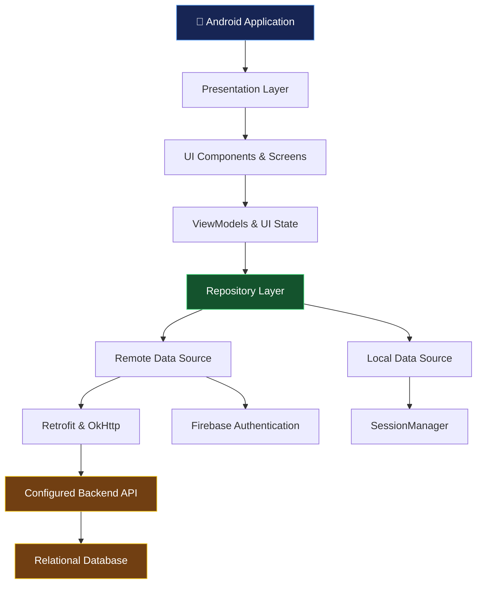
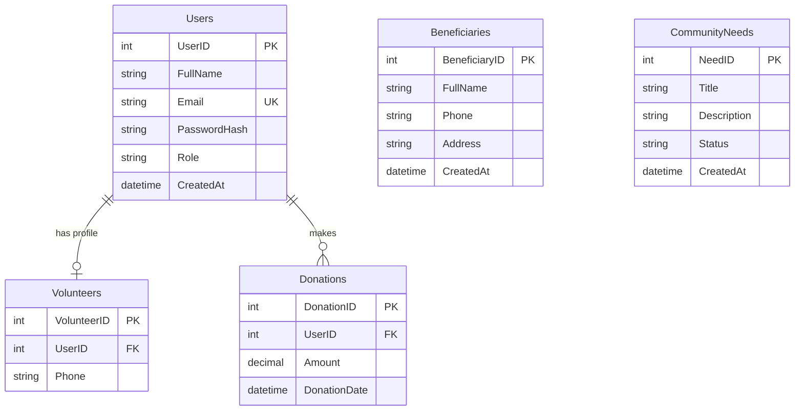

# 🌟 Aurorah CAN Digital Hub

<p align="center">
  <strong>Connecting Communities. Empowering People. Creating Lasting Impact.</strong>
  <br />
  A community-focused Android application built to connect people who need help with those who can provide it.
</p>

<p align="center">
  <a href="https://github.com/AurorahCAN/AurorahCANDigitalHub/actions">
    
  </a>
  
  
  
  
  
</p>

---

## 📖 About the Project

**Aurorah CAN Digital Hub** is a community-driven mobile application developed for the **Aurorah Community Action Network (CAN)**.

The platform aims to simplify community support by bringing beneficiaries, volunteers, and donors together in one accessible digital environment. Instead of allowing community needs and offers of assistance to remain disconnected, the application provides a central place to discover needs, request help, offer support, and explore donation opportunities.

From community assistance requests to volunteer participation and financial contributions, Aurorah CAN Digital Hub uses technology to make community engagement more accessible and organised.

### 🎯 Our Mission

To strengthen local communities by making it easier for people to access assistance, contribute their skills, support meaningful causes, and participate in initiatives that create positive social change.

---

## ✨ Key Features

### 🔐 Authentication & Account Management

- **User Registration & Login** — Create an account and access the application.
- **Google Sign-In** — Firebase Authentication and Google Play Services integration.
- **Input Validation** — Validate user input before submitting authentication forms.
- **Session Management** — Maintain authentication state across application sessions.
- **Role-Aware Experiences** — Support different user journeys for community participants.
- **Account Settings** — Manage personal preferences and account-related settings.

### 🆘 Community Assistance

- **Get Help** — Access the assistance request workflow.
- **Community Needs Feed** — Browse community needs and opportunities to provide support.
- **Priority Indicators** — Identify requests labelled Critical, High, Medium, or Low.
- **Assistance Offers** — Allow volunteers to offer relevant support through interactive forms.
- **Request Details** — Review information about community needs before offering assistance.

### 🤝 Volunteer Engagement

- **Volunteer Registration** — Provide information required to participate in community initiatives.
- **Volunteer Opportunities** — Discover ways to contribute to local projects.
- **Skills & Availability** — Support the coordination of assistance based on volunteer capabilities and availability.
- **Community Participation** — Help connect willing volunteers with opportunities to make a difference.

### 💝 Donations & Financial Contributions

- **Donation Interface** — Access the application's donation workflow.
- **Donation Categories** — Organise contributions around community-support objectives.
- **Transaction References** — Support identifiable donation transaction records.
- **Donation Information** — Present relevant information during the donation process.

> **Note:** Available payment methods, payment-provider integration, and transaction-processing behaviour depend on the configured implementation. A donation interface alone does not imply that live payments are enabled.

### 📰 Home Dashboard & Community News

- **Community News Feed** — Browse community updates and stories.
- **Featured Content** — Highlight important information and community initiatives.
- **Quick Navigation** — Access key areas of the application from the home screen.
- **Community Needs Overview** — Discover opportunities to request or provide assistance.

### ⚙️ Personalisation & Settings

- **Light & Dark Themes** — Switch between supported visual themes.
- **Password Management** — Access the password update workflow.
- **Notification Preferences** — Configure available notification settings.
- **Session Logout** — End the current session and return to the authentication flow.

---

## 🛠️ Technology Stack

The project combines native Android development technologies with a modular application structure designed to keep user interfaces, data access, networking, and session management organised.

| Technology | Purpose |
|---|---|
| [Kotlin](https://kotlinlang.org/) | Primary application programming language |
| [Android SDK](https://developer.android.com/) | Native Android application development |
| [Jetpack Compose](https://developer.android.com/jetpack/compose) | Declarative UI development |
| [Material Design 3](https://m3.material.io/) | UI components and visual design |
| XML Layouts & ViewBinding | View-based screens and layout interaction |
| Android Navigation Component | Application navigation |
| [Retrofit](https://square.github.io/retrofit/) | HTTP API communication |
| [OkHttp](https://square.github.io/okhttp/) | HTTP client and network interception |
| [Gson](https://github.com/google/gson) | JSON serialisation and deserialisation |
| [Firebase Authentication](https://firebase.google.com/docs/auth) | Authentication integration |
| Google Play Services Auth | Google account sign-in |
| AndroidX Security Crypto | Encrypted local preference support |
| [Azure SQL / SQL Server](https://azure.microsoft.com/en-us/products/azure-sql/database) | Relational database schema |
| [Gradle](https://gradle.org/) | Build automation and dependency management |
| [GitHub Actions](https://github.com/features/actions) | Continuous integration |

### 📱 Android Compatibility

- **Minimum SDK:** API 26 — Android 8.0 Oreo
- **Compile SDK:** API 34 — Android 14
- **Programming Language:** Kotlin
- **Build Configuration:** Gradle Kotlin DSL

---

## 🏗️ Application Architecture

The application follows an **MVVM-inspired architecture** and uses the Repository Pattern to separate presentation logic from data access and networking responsibilities.

This structure helps make the codebase easier to understand, maintain, test, and extend.



### Architectural Responsibilities

| Layer | Responsibility |
|---|---|
| Presentation | Displays screens, forms, dialogs, and navigation |
| ViewModels | Manages screen-related state and presentation logic where implemented |
| Repository | Coordinates application data access |
| Remote Data | Handles API communication and authentication integration |
| Local Data | Manages locally persisted session information and preferences |
| Database | Defines relational structures for community-related records |

The repository includes both Jetpack Compose and traditional XML-based Android UI components, allowing the application to support different screen implementations within the same project.

---

## 🗄️ Database Design

The project includes a relational database schema in:

`database/schema_and_seed.sql`

The SQL script uses **T-SQL**, making it suitable for Microsoft SQL Server and Azure SQL Database environments.

### Core Entities

| Table | Description |
|---|---|
| `Users` | Stores account information, email addresses, password hashes, roles, and creation timestamps |
| `Volunteers` | Stores volunteer-related contact information linked to user accounts |
| `Beneficiaries` | Stores beneficiary information, including contact details and addresses |
| `CommunityNeeds` | Records community needs, descriptions, statuses, and creation timestamps |
| `Donations` | Records donation amounts, dates, and optional links to user accounts |

### Entity Relationship Diagram



The diagram represents the relationships explicitly defined in the supplied database schema. Beneficiary and community-need relationships can be extended as the backend data model evolves.

---

## 📂 Project Structure

```text
AurorahCANDigitalHub/
│
├── .github/
│   └── workflows/
│       └── android_ci.yml
│
├── app/
│   ├── build.gradle.kts
│   └── src/
│       ├── main/
│       │   ├── java/com/aurorah/can/
│       │   │   ├── data/
│       │   │   │   ├── api/
│       │   │   │   │   ├── ApiRepository.kt
│       │   │   │   │   ├── ApiService.kt
│       │   │   │   │   ├── AuthInterceptor.kt
│       │   │   │   │   └── RetrofitClient.kt
│       │   │   │   ├── local/
│       │   │   │   │   └── SessionManager.kt
│       │   │   │   └── model/
│       │   │   │       └── Models.kt
│       │   │   │
│       │   │   ├── ui/
│       │   │   │   ├── assistance/
│       │   │   │   ├── auth/
│       │   │   │   ├── components/
│       │   │   │   ├── donation/
│       │   │   │   ├── gethelp/
│       │   │   │   ├── getinvolved/
│       │   │   │   ├── home/
│       │   │   │   ├── navigation/
│       │   │   │   ├── needs/
│       │   │   │   ├── settings/
│       │   │   │   ├── theme/
│       │   │   │   └── volunteer/
│       │   │   │
│       │   │   ├── util/
│       │   │   │   └── InputValidator.kt
│       │   │   │
│       │   │   └── MainActivity.kt
│       │   │
│       │   ├── res/
│       │   │   ├── anim/
│       │   │   ├── color/
│       │   │   ├── drawable/
│       │   │   ├── layout/
│       │   │   ├── menu/
│       │   │   ├── navigation/
│       │   │   └── values/
│       │   │
│       │   └── AndroidManifest.xml
│       │
│       ├── test/
│       └── androidTest/
│
├── database/
│   └── schema_and_seed.sql
│
├── build.gradle.kts
├── settings.gradle.kts
├── gradle/
└── README.md
```

---

## 🚀 Getting Started

Follow these instructions to set up the project locally.

### Prerequisites

Before getting started, ensure you have:

- [Android Studio](https://developer.android.com/studio)
- JDK 11 or a compatible JDK supported by the project's Gradle and Android Gradle Plugin versions
- Android SDK Platform 34
- Android SDK Build Tools
- Git
- An Android emulator or a physical Android device running API 26 or higher

If you need backend connectivity, you will also need access to a compatible backend API and its required configuration.

### 1. Clone the Repository

```bash
git clone https://github.com/AurorahCAN/AurorahCANDigitalHub.git
cd AurorahCANDigitalHub
```

### 2. Configure Firebase

If you intend to use Firebase Authentication or Google Sign-In:

1. Open the [Firebase Console](https://console.firebase.google.com/).
2. Create or select the appropriate Firebase project.
3. Register the Android application using its configured application ID.
4. Download the corresponding `google-services.json`.
5. Place the file inside the `app/` directory.

Expected location:

```text
AurorahCANDigitalHub/
└── app/
    └── google-services.json
```

**Important:** Do not commit private credentials, service account keys, or other sensitive configuration to a public repository. Use environment-specific configuration and appropriate secret-management practices.

### 3. Open the Project

1. Launch Android Studio.
2. Select **Open** and choose the cloned project directory.
3. Allow Gradle to synchronise dependencies.
4. Resolve any SDK or JDK configuration prompts.

### 4. Build the Application

On Windows, use the Gradle wrapper:

```powershell
.\gradlew.bat assembleDebug
```

On macOS or Linux:

```bash
./gradlew assembleDebug
```

### 5. Run the Application

Connect an Android device with USB debugging enabled or start an emulator.

On Windows:

```powershell
.\gradlew.bat installDebug
```

On macOS or Linux:

```bash
./gradlew installDebug
```

Alternatively, select your target device in Android Studio and click **Run**.

---

## 🧪 Testing

Testing helps verify application behaviour, validate input handling, and reduce regressions as new features are introduced.

### Run Unit Tests

Windows:

```powershell
.\gradlew.bat test
```

macOS / Linux:

```bash
./gradlew test
```

### Run Instrumentation Tests

An Android emulator or connected device is required.

Windows:

```powershell
.\gradlew.bat connectedAndroidTest
```

macOS / Linux:

```bash
./gradlew connectedAndroidTest
```

### Test Coverage Areas

The repository includes tests for areas such as:

- Login behaviour
- Session management
- Input validation
- Android instrumentation testing

Additional test coverage can be added as application workflows and backend integrations expand.

---

## 🔄 Continuous Integration

The repository includes a GitHub Actions workflow:

`.github/workflows/android_ci.yml`

The workflow is intended to automate Android build verification and testing when configured triggers run.

Depending on the workflow configuration, automated checks can include:

- JDK setup
- Gradle dependency caching
- Application compilation
- Unit test execution

[**View GitHub Actions →**](https://github.com/AurorahCAN/AurorahCANDigitalHub/actions)

---

## 🔒 Security Considerations

Community platforms can handle sensitive personal information, making security an important part of the development process.

The project includes or integrates with security-related components such as session management, authentication libraries, input validation, and AndroidX Security Crypto.

Recommended practices for deployment and continued development include:

- Never store plaintext passwords.
- Use an appropriate password-hashing algorithm on the authentication backend.
- Keep authentication tokens and sensitive preferences protected.
- Validate user input on both the client and server.
- Use HTTPS for production API communication.
- Never expose Firebase service account credentials or backend secrets.
- Enforce authorisation on the backend rather than relying solely on client-side role checks.
- Avoid storing unnecessary personal or financial information.
- Verify payment-provider integration and transaction confirmation before treating a donation as completed.

Security features should be reviewed against the actual implementation and deployment configuration before the application is used with real community data.

---

## 🗺️ Future Development Opportunities

Potential improvements for future iterations include:

- [ ] Push notifications for assistance requests and community updates
- [ ] Enhanced community-need filtering and search
- [ ] Improved volunteer-to-request coordination
- [ ] Expanded accessibility and multilingual support
- [ ] Additional automated tests and code-quality checks
- [ ] Production-ready backend integration and monitoring
- [ ] Verified payment-provider integration and donation reconciliation
- [ ] Community impact reporting and analytics
- [ ] Improved privacy controls and data-retention management

These are possible development directions, not a claim that every item is currently implemented.

---

## 🤝 Contributing

Contributions, suggestions, and improvements are welcome.

To contribute:

1. Fork the repository.
2. Create a feature branch.
3. Make your changes.
4. Run the relevant tests.
5. Commit your work using a descriptive message.
6. Push your branch and open a pull request.

Example:

```bash
git checkout -b feature/community-improvements
git add .
git commit -m "feat: improve community assistance workflow"
git push origin feature/community-improvements
```

When contributing, please aim for readable code, consistent naming, useful comments, and changes that fit the existing application architecture.

---

## 📄 License

This project is distributed under the **MIT License**. See the [`LICENSE`](LICENSE) file for details.

---

## ❤️ Acknowledgements

Developed for the **Aurorah Community Action Network (CAN)** with the goal of making community assistance more accessible, coordinated, and impactful.

Every feature represents another opportunity to connect someone who needs help with someone who can provide it.

<p align="center">
  <strong>Built with Kotlin. Driven by community. Designed to make a difference. 🌍</strong>
  <br />
  <sub>Because changing the world is a team project — and the community is the whole point.</sub>
</p>
