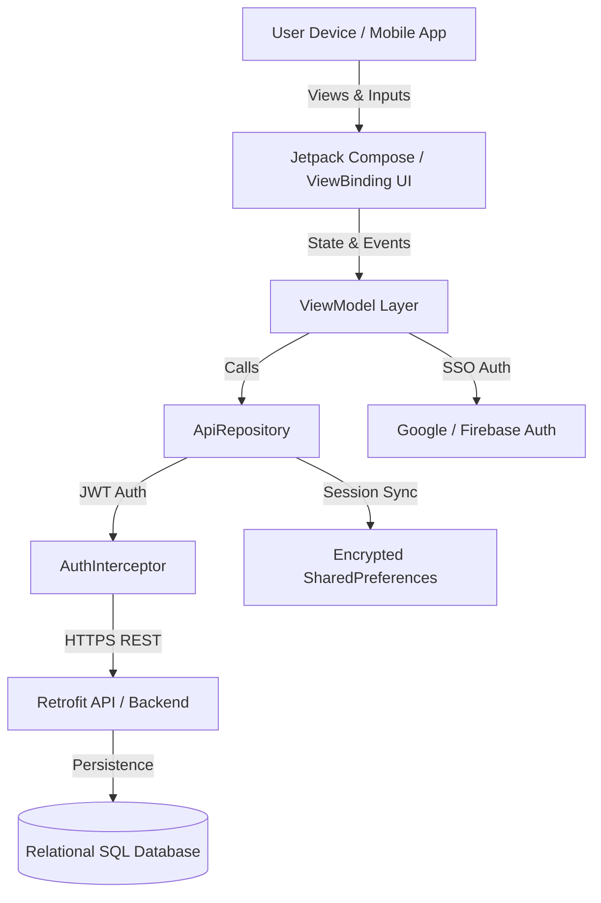
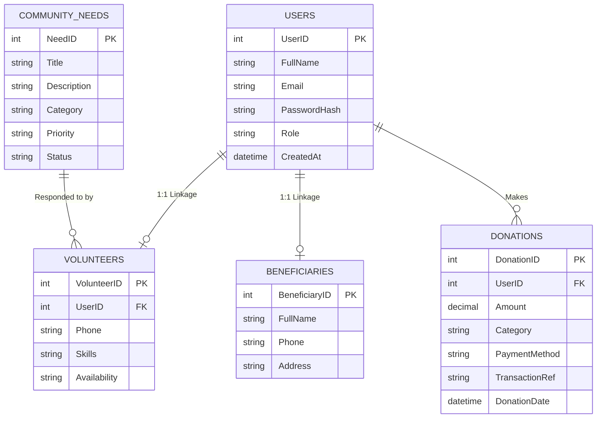

# 🌍 Aurorah CAN Digital Hub

<p align="center">
  
</p>

<p align="center">
  <a href="https://developer.android.com/"></a>
  <a href="https://kotlinlang.org/"></a>
  <a href="https://developer.android.com/jetpack/compose"></a>
  <a href=".github/workflows/android_ci.yml"></a>
  <a href="database/schema_and_seed.sql"></a>
  <a href="app/src/main/java/com/aurorah/can/data/local/SessionManager.kt"></a>
  <a href="LICENSE"></a>
</p>

---

**Aurorah CAN Digital Hub** is an advanced, community-centered mobile platform built for the **Aurorah Community Action Network (CAN)**. The application connects volunteers, beneficiaries, and donors in a unified digital ecosystem to report community aid requests, deploy real-time volunteer assistance, process transparent financial contributions, and broadcast local social impact updates across South Africa.

---

## 📌 Table of Contents
1. [📱 Application Purpose & Mission](#-application-purpose--mission)
   - [Target Audience & Personas](#target-audience--personas)
   - [Core Operational Workflows](#core-operational-workflows)
2. [🎨 Design Considerations & Technical Architecture](#-design-considerations--technical-architecture)
   - [1. UI/UX Philosophy & Modernization](#1-uiux-philosophy--modernization)
   - [2. Software Architecture & Design Patterns](#2-software-architecture--design-patterns)
   - [3. Security, SSO & Session Management](#3-security-sso--session-management)
   - [4. Accessibility, Inclusivity & Multilingual Engine](#4-accessibility-inclusivity--multilingual-engine)
   - [5. Relational Database Architecture](#5-relational-database-architecture)
3. [📸 App Screenshots & Visual Walkthrough](#-app-screenshots--visual-walkthrough)
4. [🤖 Utilisation of GitHub & GitHub Actions CI/CD](#-utilisation-of-github--github-actions-cicd)
   - [1. Branching Strategy & Workflow](#1-branching-strategy--workflow)
   - [2. DevOps CI Pipeline Breakdown](#2-devops-ci-pipeline-breakdown)
5. [📱 Aurorah CAN Digital Hub — App Release Notes](#-aurorah-can-digital-hub--app-release-notes)
   - [Overview](#overview)
   - [🚀 Key Innovative Features & Updates](#-key-innovative-features--updates)
   - [🛠️ Summary Comparison Matrix](#%EF%B8%8F-summary-comparison-matrix)
6. [📊 System & Database Diagrams](#-system--database-diagrams)
7. [🛠️ Build, Test & Deployment Guide](#%EF%B8%8F-build-test--deployment-guide)
8. [📄 License & Credits](#-license--credits)

---

## 📱 Application Purpose & Mission

The **Aurorah Community Action Network (CAN)** operates in diverse socio-economic environments across South Africa where rapid, localized aid distribution is essential. Traditional aid delivery methods suffer from fragmented communication, delayed response times, lack of transparent financial tracking, and language accessibility barriers. 

The **Aurorah CAN Digital Hub** solves these critical challenges by providing an all-in-one digital marketplace for community support.

> [!IMPORTANT]
> **Mission Statement**: To democratize community aid by bridging the gap between vulnerable households, active social volunteers, and financial donors through secure, accessible, and transparent mobile technology.

```
                  +-----------------------------------+
                  |     Aurorah CAN Digital Hub       |
                  +-----------------------------------+
                                    |
         +--------------------------+--------------------------+
         |                          |                          |
         v                          v                          v
+------------------+       +------------------+       +------------------+
|   Beneficiaries  |       |    Volunteers    |       |      Donors      |
|  Report Needs &  |       | Offer Skills &   |       |  Fund Specific   |
| Receive Aid      |       | Respond to Needs |       |  Causes & Causes |
+------------------+       +------------------+       +------------------+
```

### Target Audience & Personas

| Persona | Role & Objectives | Key App Touchpoints |
| :--- | :--- | :--- |
| **Beneficiary** | Families or individuals requiring essential aid (food parcels, clothing, educational support, emergency relief). | `GetHelpScreen`, `RequestAssistanceBottomSheetFragment`, Priority Badges |
| **Volunteer** | Community members willing to donate time, technical skills, labor, or transportation. | `CommunityNeedsSubTab.kt`, `OfferAssistanceDialog.kt`, `VolunteerScreen.kt` |
| **Donor** | Individuals or corporate sponsors contributing financial aid to transparent community initiatives. | `DonateSubTab.kt`, `DonationFragment`, Transaction Receipts (`TXN-...`) |
| **Admin / Coordinator** | Community leaders managing aid distribution, validating requests, and sharing local news updates. | `HomeScreen` News Feed, Category Management, Profile & Settings Controls |

---

## 🎨 Design Considerations & Technical Architecture

### 1. UI/UX Philosophy & Modernization
The user interface was crafted following **Google Material Design 3 (M3)** guidelines to guarantee clarity, warmth, and ease of use under field conditions.

<p align="center">
  
</p>

- **Hybrid UI Integration**: Combines traditional, reliable Android XML ViewBinding fragments with modern **Jetpack Compose Material 3** dynamic composables (`HomeScreen`, `GetHelpScreen`, `VolunteerScreen`, `GetInvolvedScreen`, `CommunityNeedsSubTab`, `DonateSubTab`).
- **Interactive Bottom Sheet Components**: Essential flows (e.g., offering assistance, viewing news details, requesting aid) utilize touch-friendly bottom sheets to maintain user context without screen flickering.
- **Priority Badging System**: Urgency levels are visually reinforced through color-coded badges:
  - 🔴 **Urgent / Critical**: Emergency relief / Immediate risk
  - 🟠 **High**: Urgent assistance required within 24-48 hours
  - 🟡 **Medium**: Standard community aid
  - 🟢 **Low**: Long-term development support

### 2. Software Architecture & Design Patterns
The application follows modern Android best practices utilizing the **MVVM (Model-View-ViewModel)** pattern with the **Repository Pattern** for unidirectional data flow.

```
 [ UI Layer (Compose / ViewBinding) ]
               │
      (Exposes UI State)
               ▼
   [ ViewModel (StateFlow / LiveData) ]
               │
       (Calls Repository)
               ▼
     [ ApiRepository Layer ]
        /             \
       v               v
[ Retrofit API ]   [ SessionManager (Encrypted Prefs) ]
```

- **Declarative & Reactive State**: Screen state is maintained via `StateFlow` and `LiveData` to guarantee instantaneous UI updates when filtering needs or processing forms.
- **Networking & Resilience**: Powered by **Retrofit 2** and **OkHttp 4** with logging interceptors. Includes a robust fallback mechanism ensuring seamless user operation.
- **Image Loading & Optimization**: Employs **Coil (Coroutines Image Loading)** for fast, asynchronous memory and disk cached image rendering.

### 3. Security, SSO & Session Management
Security was engineered as a core foundation:

- **Google Single Sign-On (SSO) & Firebase Auth**: Integrated via `GoogleSignInClient` and Firebase Auth (`/api/auth/google-sso`) to offer one-tap social login alongside email/password authentication.
- **Encrypted Local Persistence**: Utilizes `EncryptedSharedPreferences` (`androidx.security:security-crypto`) to safeguard user session tokens, user profiles, and security keys on device.
- **Auth Interceptor**: Implements `AuthInterceptor` to automatically inject JWT Bearer Tokens (`Authorization: Bearer <token>`) into authenticated API requests.
- **RFC-Compliant Input Validation**: Robust validation for standard email formatting (`InputValidator.isValidEmail`) and strong password security requirements.

### 4. Accessibility, Inclusivity & Multilingual Engine
Recognizing South Africa's diverse demographic landscape, the app features an integrated **Multilingual Localization Engine**.

> [!TIP]
> **Supported Languages**:
> - 🇬🇧 **English** (`en`) - Default
> - 🇿🇦 **isiZulu** (`zu`) - Fully Translated (`res/values-zu/strings.xml`)
> - 🇿🇦 **Afrikaans** (`af`) - Fully Translated (`res/values-af/strings.xml`)
> - 🇿🇦 **isiXhosa** (`xh`) - Fully Translated (`res/values-xh/strings.xml`)

- **Dynamic Runtime Locale Switch**: Language preferences configured in `SettingsFragment` take effect immediately across all screens using `AppCompatDelegate.setApplicationLocales()`.
- **Accessible Typography & Contrast**: Text scales gracefully across screen densities with high contrast ratios for readability in direct sunlight.

---

## 📸 App Screenshots & Visual Walkthrough

Below are the key application screens demonstrating the user interface and feature flows across authentication, home dashboard, aid request, volunteer matching, donation pledges, and system settings:

| 1. Home Dashboard | 2. Request Help / Get Assistance | 3. Volunteer Application |
| :---: | :---: | :---: |
|  |  |  |
| *Local Needs & Action Buttons* | *POPIA-Compliant Help Request* | *Skills & Availability Matrix* |

| 4. Community Needs Feed | 5. Monetary & In-Kind Pledge | 6. User Profile & Dark Mode |
| :---: | :---: | :---: |
|  |  |  |
| *Live Progress & Priority Badges* | *Preset & Custom ZAR Amounts* | *Role Badges & Night Theme Toggle* |

| 7. Create Account & Google SSO |
| :---: |
|  |
| *Role Selection & Google Sign-In* |

---

## 🤖 Utilisation of GitHub & GitHub Actions CI/CD

### 1. Branching Strategy & Workflow
The repository strictly adheres to Git Best Practices with a structured feature-branch workflow:

- **`main`**: Production-ready release branch. All code must pass automated CI pipeline checks before merging.
- **`develop`**: Active integration branch for upcoming releases.
- **`feature/*`**: Isolated feature branches for individual screen development or API implementations.

### 2. DevOps CI Pipeline Breakdown
The repository features an automated Continuous Integration pipeline defined in [.github/workflows/android_ci.yml](.github/workflows/android_ci.yml).

```yaml
name: Android CI / DevOps Pipeline

on:
  push:
    branches: [ "main", "develop" ]
  pull_request:
    branches: [ "main" ]

jobs:
  build_and_test:
    runs-on: ubuntu-latest
    steps:
      - name: Checkout Repository
        uses: actions/checkout@v4

      - name: Set up JDK 17
        uses: actions/setup-java@v3
        with:
          java-version: '17'
          distribution: 'temurin'
          cache: gradle

      - name: Grant Execute Permission for Gradle Wrapper
        run: chmod +x gradlew

      - name: Run Unit Tests
        run: ./gradlew testDebugUnitTest --continue

      - name: Build Debug APK
        run: ./gradlew assembleDebug
```

---

## 📱 Aurorah CAN Digital Hub — App Release Notes

### Overview
Since the initial prototype, the Aurorah CAN Digital Hub has evolved from a basic prototype into a feature-complete, production-ready community action platform. Key additions include one-touch Google SSO, an interactive Community Needs portal with direct assistance capabilities, a live Home Page News & Story feed, dynamic South African multi-language support, and refined donation processing.

---

### 🚀 Key Innovative Features & Updates

#### 1. Google Single Sign-On (SSO) & Firebase Auth Integration
- **One-Tap Authentication**: Integrated Google Sign-In (`GoogleSignInClient`) into both `LoginActivity` and `RegisterActivity`, allowing users to register or log in instantly using their Google credentials. *(See Screenshot 7)*
- **Token Exchange**: Backend security powered by Firebase ID Token verification (`/api/auth/google-sso`) ensuring seamless, cryptographically verified user sessions.
- **Secondary Info Completion**: Integrated `SecondaryInfoDialogs` to prompt Google SSO users for missing required profile metadata (phone number, national ID, preferred role) post-login.

#### 2. Live News & Impact Stories on Home Dashboard
- **Home Feed Integration**: Added a dedicated News & Announcements section to `HomeScreen` featuring card layouts with category badges, publish dates, and summary teasers. *(See Screenshot 1)*
- **Full-Article Bottom Sheet**: Created `NewsDetailBottomSheetFragment` allowing users to expand news articles into a rich reading view with external source linking and share capabilities.
- **Featured Stories Carousel**: Added `FeaturedStoryCard` components showcasing real-world community impact and testimonial stories to foster donor and volunteer engagement.

#### 3. Interactive Community Needs Portal & Direct Assistance
- **Sub-Tab & Needs Discovery**: Created the Community Needs interface (`CommunityNeedsSubTab.kt`) displaying community requests categorized by urgency priority badges (Urgent, High, Medium, Low). *(See Screenshot 4)*
- **Detailed Needs Screen**: Implemented `CommunityNeedDetailScreen.kt` featuring live goal progress metrics, item fulfillment status, and Google Maps location integration.
- **Offer Assistance Modal**: Added an interactive bottom sheet dialog (`OfferAssistanceDialog.kt`) enabling community members to offer physical items, financial aid, or volunteer services directly against a specific need. *(See Screenshot 2)*

#### 4. South African Multi-Language & Localization Support
- **In-App Language Switching**: Added dynamic localization supporting four official South African languages:
  - 🇬🇧 **English** (`en`)
  - 🇿🇦 **isiZulu** (`zu`)
  - 🇿🇦 **Afrikaans** (`af`)
  - 🇿🇦 **isiXhosa** (`xh`)
- **Dynamic Persistence**: Powered by `AppCompatDelegate.setApplicationLocales()` and `SessionManager`, applying selected language preferences across the application without requiring an app restart.

#### 5. Streamlined Donation & Campaign Portal
- **Preset & Custom Contributions**: Redesigned the `DonateSubTab` with quick-select monetary preset buttons (e.g., R50, R100, R250, R500, R1000), custom amount input validation (`DonationInputValidator`), and campaign targeting. *(See Screenshot 5)*
- **Itemized Direct Giving**: Added support for non-monetary, itemized community campaign donations (food parcels, clothing, school supplies).

#### 6. Volunteer Onboarding & Skill Matching
- **Skill & Availability Matrix**: Added `VolunteerForm` and `VolunteerScreen`, allowing volunteers to select areas of expertise (e.g., Logistics, Healthcare, Education), availability schedules, and location preferences. *(See Screenshot 3)*
- **Role-Based Profiles**: Automated volunteer status mapping in user profiles upon application submission.

#### 7. System Controls & UX Preferences
- **Dark / Night Mode Toggle**: Added a system-wide Dark Mode toggle in `SettingsFragment` with live UI recalculation via `AppCompatDelegate`. *(See Screenshot 6)*
- **Country Code Selector**: Integrated a searchable `CountryCodeDropdown` component supporting international and local phone number formats (+27 South Africa default).
- **Data Saver & Push Notification Toggles**: User controls for optimizing data consumption in resource-constrained environments.

---

### 🛠️ Summary Comparison Matrix

| Feature / Area | Initial Prototype | Current Release |
| :--- | :--- | :--- |
| **Authentication** | Standard Email/Password form | Google SSO + Firebase Auth + Secondary Info Collection |
| **Home Screen** | Static placeholder cards | Live News Feed, Story Carousel, Urgent Need Summaries |
| **Community Needs** | Basic read-only list | Categorized Feed, Detail View, "Offer Assistance" Dialog |
| **Donations** | Static form | Preset Amount Buttons, Input Validation, Campaign Selector |
| **Localization** | English only | Multilingual (English, isiZulu, Afrikaans, isiXhosa) |
| **User Settings** | Empty profile tab | Dark Mode, Language Picker, Profile Editing, Account Control |

---

## 📊 System & Database Diagrams

### System Architecture Flow



### Entity Relationship Diagram (ERD)



---

## 🛠️ Build, Test & Deployment Guide

### Prerequisites
- **Android Studio**: Hedgehog (2023.1.1) or Ladybug (2024.2+)
- **JDK**: Java Development Kit 17
- **Android SDK**: API Level 34 / 36
- **Gradle**: 8.7+

### Step-by-Step Setup

1. **Clone the Repository**:
   ```bash
   git clone https://github.com/AurorahCAN/AurorahCANDigitalHub.git
   cd AurorahCANDigitalHub
   ```

2. **Open in Android Studio**:
   - Launch Android Studio and select **Open Existing Project**.
   - Choose the root directory `AurorahCANDigitalHub`.

3. **Gradle Sync & Build**:
   ```bash
   ./gradlew build
   ```

4. **Run Unit Test Suite**:
   ```bash
   ./gradlew testDebugUnitTest
   ```

5. **Assemble Debug APK**:
   ```bash
   ./gradlew assembleDebug
   ```
   *The generated APK file will be output to:* `app/build/outputs/apk/debug/Aurorah_CAN_Digital_Hub_debug.apk`

6. **Run UI Instrumentation Tests** (Requires connected emulator or physical device):
   ```bash
   ./gradlew connectedAndroidTest
   ```

---

## 📄 License & Credits

Designed and developed for the **Aurorah Community Action Network (CAN)**.

- **License**: Released under the open-source [MIT License](LICENSE).
- **Icons & Graphics**: Material Design Icons & Custom Aurorah CAN Assets.
- **Support**: For inquiries or community collaboration, visit [aurorahcan.org.za](https://aurorahcan.org.za).

---
*Built with ❤️ in South Africa for community empowerment.*
