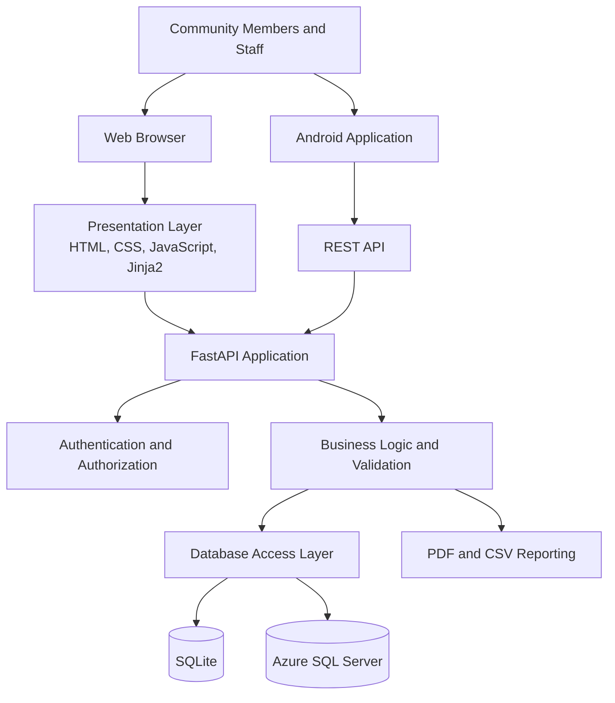
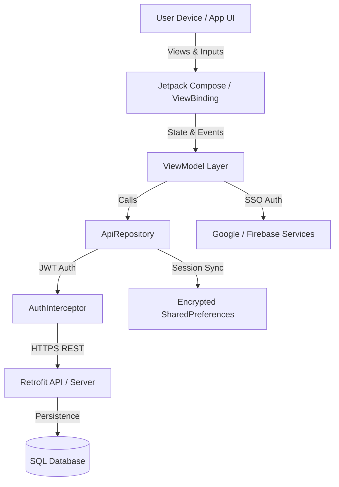
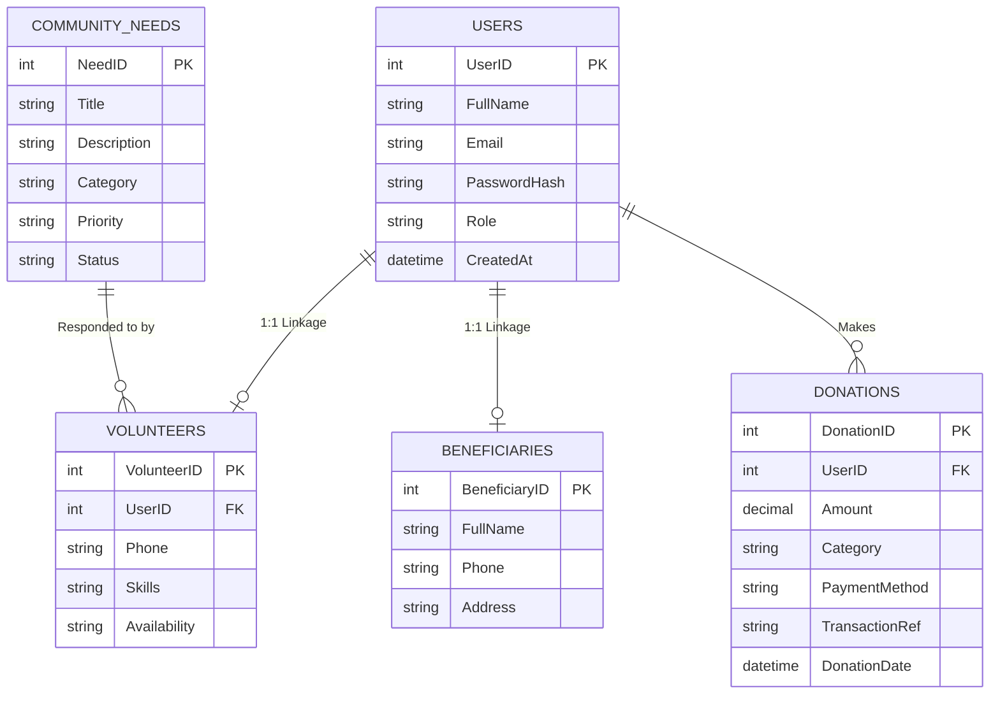

# 🌍 Aurorah CAN Digital Hub


[-brightgreen.svg)](https://developer.android.com/)
[](https://kotlinlang.org/)
[](https://developer.android.com/jetpack/compose)
[](.github/workflows/android_ci.yml)
[](database/schema_and_seed.sql)
[](app/src/main/java/com/aurorah/can/data/local/SessionManager.kt)
[](LICENSE)

**Aurorah CAN Digital Hub** is an advanced, community-centered mobile platform built for the **Aurorah Community Action Network (CAN)**. The application connects volunteers, beneficiaries, and donors in a unified digital ecosystem to report community aid requests, deploy real-time volunteer assistance, process transparent financial contributions, and broadcast local social impact updates across South Africa.

---

## 📌 Table of Contents
1. [📱 Application Purpose & Mission](#-application-purpose--mission)
   - [Target Audience & Personas](#target-audience--personas)
   - [Core Operational Workflows](#core-operational-workflows)
2. [🎨 Design Considerations & Technical Architecture](#-design-considerations--technical-architecture)
   - [UI/UX Philosophy & Modernization](#1-uiux-philosophy--modernization)
   - [Software Architecture & Design Patterns](#2-software-architecture--design-patterns)
   - [Security, SSO & Session Management](#3-security-sso--session-management)
   - [Accessibility, Inclusivity & Multilingual Engine](#4-accessibility-inclusivity--multilingual-engine)
   - [Relational Database Architecture](#5-relational-database-architecture)
3. [🤖 Utilisation of GitHub & GitHub Actions CI/CD](#-utilisation-of-github--github-actions-cicd)
   - [Branching Strategy & Workflow](#1-branching-strategy--workflow)
   - [DevOps CI Pipeline Breakdown](#2-devops-ci-pipeline-breakdown)
4. [🚀 Version 1.0.1 Release Notes & Innovative Features](#-version-101-release-notes--innovative-features)
   - [Summary of Updates Since Prototype](#summary-of-updates-since-prototype)
   - [Key Innovative Features Spotlight](#key-innovative-features-spotlight)
5. [📊 System & Database Diagrams](#-system--database-diagrams)
6. [🛠️ Build, Test & Deployment Guide](#%EF%B8%8F-build-test--deployment-guide)
7. [📄 License & Credits](#-license--credits)

---

## 📱 Application Purpose & Mission

The **Aurorah Community Action Network (CAN)** operates in diverse socio-economic environments where rapid, localized aid distribution is essential. Traditional aid delivery methods suffer from fragmented communication, delayed response times, lack of transparent financial tracking, and language accessibility barriers. 

The **Aurorah CAN Digital Hub** solves these critical challenges by providing an all-in-one digital marketplace for community support.

> [!IMPORTANT]
> **Mission Statement**: To democratize community aid by bridging the gap between vulnerable households, active social volunteers, and financial donors through secure, accessible, and transparent mobile technology.

```
                  +-----------------------------------+
                  |     Aurorah CAN Digital Hub       |
                  +-----------------------------------+
                                    |
         +--------------------------+--------------------------+
         |                          |                          |
         v                          v                          v
+------------------+       +------------------+       +------------------+
|   Beneficiaries  |       |    Volunteers    |       |      Donors      |
|  Report Needs &  |       | Offer Skills &   |       |  Fund Specific   |
| Receive Aid      |       | Respond to Needs |       |  Causes & Causes |
+------------------+       +------------------+       +------------------+
```

### Target Audience & Personas

| Persona | Role & Objectives | Key App Touchpoints |
| :--- | :--- | :--- |
| **Beneficiary** | Families or individuals requiring essential aid (food parcels, clothing, educational support, emergency relief). | `GetHelpScreen`, `RequestAssistanceBottomSheetFragment`, `PriorityBadge` |
| **Volunteer** | Community members willing to donate time, technical skills, labor, or transportation. | `CommunityNeedsSubTab`, `OfferAssistanceDialog`, `VolunteerScreen` |
| **Donor** | Individuals or corporate sponsors contributing financial aid to transparent community initiatives. | `DonateSubTab`, `DonationFragment`, Transaction Receipts (`TXN-...`) |
| **Admin / Leader** | Community coordinators managing aid distribution, validating requests, and sharing local news updates. | `HomeScreen` News Feed, Category Management, Profile & Settings Controls |

### Core Operational Workflows

1. **Aid Request & Categorization**: Beneficiaries log aid requests specifying category (Food, Clothing, Education, Healthcare, Infrastructure) and emergency priority (`Critical`, `High`, `Medium`, `Low`).
2. **Volunteer Matching & Response**: Volunteers browse filtered live needs feeds, select items matching their skills/locality, and submit structured offers of assistance.
3. **Transparent Financial Giving**: Donors select verified cause funds (e.g., *Youth Education Fund*, *Emergency Relief*), choose payment methods (Card, EFT, Mobile Pay), and receive instant unique reference receipts.
4. **Impact Storytelling & News**: Dynamic community update stream displaying local news, press releases, and success stories to foster trust and engagement.

---

## 🎨 Design Considerations & Technical Architecture

### 1. UI/UX Philosophy & Modernization
The user interface was crafted following **Google Material Design 3 (M3)** guidelines to guarantee clarity, warmth, and ease of use under field conditions.

- **Hybrid UI Integration**: Combines traditional, reliable Android XML ViewBinding fragments with modern **Jetpack Compose Material 3** dynamic composables (`HomeScreen`, `GetHelpScreen`, `VolunteerScreen`, `GetInvolvedScreen`, `CommunityNeedsSubTab`, `DonateSubTab`).
- **Interactive Bottom Sheet Components**: Essential flows (e.g., offering assistance, viewing news details, requesting aid) utilize touch-friendly bottom sheets to maintain user context without screen flickering.
- **Priority Badging System**: Urgency levels are visually reinforced through color-coded badges:
  - 🔴 **Critical**: Emergency relief / Immediate risk
  - 🟠 **High**: Urgent assistance required within 24-48 hours
  - 🟡 **Medium**: Standard community aid
  - 🟢 **Low**: Long-term development support


> [!NOTE]
> **Gradient Styling & Themes**: The visual identity utilizes a bespoke custom color scheme (*Aurorah Emerald Green*, *Deep Teal*, *Sunset Orange*, and *Alert Crimson*) supported by full dynamic Light and Dark mode themes.

### 2. Software Architecture & Design Patterns
The application follows modern Android best practices utilizing the **MVVM (Model-View-ViewModel)** pattern with the **Repository Pattern** for unidirectional data flow.

### Internal staff

Staff accounts are provisioned by an operator rather than through public registration.

| Staff role     | Access scope                                                                   |
| -------------- | ------------------------------------------------------------------------------ |
| Administrator  | Operational workspaces, staff management, and audit records                    |
| Case Worker    | Beneficiary requests, community needs, and volunteer scheduling                |
| Finance        | Donation verification, allocations, financial summaries, and permitted reports |
| Content Editor | News and announcements                                                         |
| Read-Only      | Aggregated operational summaries without individual-record editing             |

Permissions are enforced on the server for dashboard data, mutations, and exports. The Read-Only role uses aggregated data rather than returning individual beneficiary contact details or individual donation and volunteer records.

---

## 🏗️ System Architecture

The system follows a three-layer architecture, separating the user interface, application logic, and data persistence.


[ UI Layer (Compose / ViewBinding) ]
               │
      (Exposes UI State)
               ▼
   [ ViewModel (StateFlow / LiveData) ]
               │
       (Calls Repository)
               ▼
     [ ApiRepository Layer ]
        /             \
       v               v
[ Retrofit API ]   [ SessionManager (Encrypted Prefs) ]
```

- **Declarative & Reactive State**: Screen state is maintained via `StateFlow` and `LiveData` to guarantee instantaneous UI updates when filtering needs or processing forms.
- **Networking & Resilience**: Powered by **Retrofit 2** and **OkHttp 4** with logging interceptors. Includes a robust `MockApiRepository` fallback system ensuring full functionality even during server offline conditions or offline demos.
- **Image Loading & Optimization**: Employs **Coil (Coroutines Image Loading)** for fast, asynchronous memory and disk cached image rendering.

### 3. Security, SSO & Session Management
Security was engineered as a core foundation rather than an afterthought:

- **Google Single Sign-On (SSO) & Firebase Auth**: Integrated via `play-services-auth` and `firebase-auth-ktx` to offer one-tap social login alongside email/password authentication.
- **Encrypted Local Persistence**: Utilizes `EncryptedSharedPreferences` (`androidx.security:security-crypto`) to safeguard user session tokens, user profiles, and security keys on device.
- **Auth Interceptor**: Implements `AuthInterceptor` to automatically inject JWT Bearer Tokens (`Authorization: Bearer <token>`) into authenticated API requests.
- **RFC-Compliant Input Validation**: Robust validation for standard email formatting (`InputValidator.isValidEmail`) and strong password security requirements (`InputValidator.isSecurePassword`).

### 4. Accessibility, Inclusivity & Multilingual Engine
Recognizing South Africa's diverse demographic landscape, the app features an integrated **Multilingual Localization Engine**.

> [!TIP]
> **Supported Languages**:
> - 🇬🇧 **English** (`en`) - Default
> - 🇿🇦 **Afrikaans** (`af`) - Fully Translated (`res/values-af/strings.xml`)
> - 🇿🇦 **isiXhosa** (`xh`) - Fully Translated (`res/values-xh/strings.xml`)
> - 🇿🇦 **isiZulu** (`zu`) - Fully Translated (`res/values-zu/strings.xml`)

- **Dynamic Runtime Locale Switch**: Language preferences configured in Settings take effect immediately across all screens using `AppCompatDelegate.setApplicationLocales()`.
- **Accessible Typography & Contrast**: Text scales gracefully across screen densities with high contrast ratios for readability in direct sunlight.

### 5. Relational Database Architecture
The platform is backed by an enterprise-grade SQL relational schema (`database/schema_and_seed.sql`) designed for MySQL, MariaDB, or Azure SQL databases.

```sql
-- Core Table Summary
Users (UserID PK, FullName, Email, PasswordHash, Role, CreatedAt)
Volunteers (VolunteerID PK, UserID FK -> Users, Phone, Skills, Availability)
Beneficiaries (BeneficiaryID PK, FullName, Phone, Address, CreatedAt)
CommunityNeeds (NeedID PK, Title, Description, Category, Priority, Status, Location)
Donations (DonationID PK, UserID FK -> Users, Amount, Category, PaymentMethod, TransactionRef, Date)
```

- **Foreign Key Integrity**: Enforces strict cascading deletions and relational mappings between user accounts and specialized role profiles.
- **Transaction Ledger**: Stores complete financial donation records with custom transaction references (`TXN-YYYYMMDD-XXXX`).

---

## 🤖 Utilisation of GitHub & GitHub Actions CI/CD

### 1. Branching Strategy & Workflow
The repository strictly adheres to Git Best Practices with a structured feature-branch workflow:

- **`main`**: Production-ready release branch. All code must pass automated CI pipeline checks before merging.
- **`develop`**: Active integration branch for upcoming releases.
- **`feature/*`**: Isolated feature branches for individual screen development or API implementations.

### 2. DevOps CI Pipeline Breakdown
The repository features an automated Continuous Integration pipeline defined in [.github/workflows/android_ci.yml](.github/workflows/android_ci.yml).

```yaml
name: Android CI / DevOps Pipeline

on:
  push:
    branches: [ "main", "develop" ]
  pull_request:
    branches: [ "main" ]

jobs:
  build_and_test:
    runs-on: ubuntu-latest
    steps:
      - name: Checkout Repository
        uses: actions/checkout@v4

      - name: Set up JDK 17
        uses: actions/setup-java@v3
        with:
          java-version: '17'
          distribution: 'temurin'
          cache: gradle

      - name: Grant Execute Permission for Gradle Wrapper
        run: chmod +x gradlew

      - name: Run Unit Tests
        run: ./gradlew testDebugUnitTest --continue

      - name: Build Debug APK
        run: ./gradlew assembleDebug
```

#### Key CI Pipeline Automation Benefits:
1. **Automated Quality Gate**: Every Pull Request against `main` automatically triggers complete unit test suites (`InputValidatorTest`, `AuthInterceptorTest`, `ModelsSerializationTest`).
2. **Environment Consistency**: standardizes on **JDK 17 (Temurin)** with automated Gradle dependency caching to optimize build speed.
3. **Automated Artifact Verification**: Builds the debug APK (`Aurorah_CAN_Digital_Hub_debug.apk`) to verify zero compilation errors exist prior to deployment.

---

## 🚀 Version 1.0.1 Release Notes & Innovative Features

### Summary of Updates Since Prototype

Since the initial prototype phase (v1.0.0), the application underwent a comprehensive transformation to reach production readiness (v1.0.1):

| Feature Area | Prototype (v1.0.0) | Current Release (v1.0.1) |
| :--- | :--- | :--- |
| **UI Framework** | Basic XML Layouts | **Jetpack Compose Material 3 Hybrid Architecture** |
| **Target SDK** | Android 31 | **Android 34 / SDK 36 (Latest Android standard)** |
| **Authentication** | Hardcoded mock login | **Firebase Auth + Google SSO + Salted BCrypt Hash** |
| **Data Security** | Plain SharedPreferences | **Banking-grade EncryptedSharedPreferences** |
| **Localization** | Monolingual (English only) | **Multilingual (English, Afrikaans, isiXhosa, isiZulu)** |
| **Theme Support** | Basic Light Mode | **Adaptive Dark Mode & Gradient Resources** |
| **DevOps** | Manual builds | **Automated GitHub Actions CI/CD Pipeline** |
| **Donations** | Static form | **Multi-category allocation with instant `TXN` receipts** |
| **Code Optimization**| Uncompressed binaries | **R8 Code Shrinking, Resource Stripping & ProGuard** |

---

### Key Innovative Features Spotlight

#### 1. ✨ Jetpack Compose Material 3 Hybrid UI Engine
> Blends Jetpack Compose composables seamlessly inside legacy Android Fragments and Activities. Allows dynamic UI re-rendering, custom animated cards (`HeroCard`, `NeedCard`, `StoryCard`), and interactive filter chips.

#### 2. 🇿🇦 Multilingual South African Localization Engine
> Full internationalization and localization across **English**, **Afrikaans**, **isiXhosa**, and **isiZulu**. Language selection updates the entire application string hierarchy dynamically at runtime without requiring application restart.

#### 3. 🔐 Encrypted Session Security & Google SSO
> Leverages Android Jetpack Security (`androidx.security:security-crypto`) to store authorization tokens inside hardware-backed encrypted storage. Pairs seamlessly with Google One-Tap SSO for frictionless user onboarding.

#### 4. 🤝 Interactive Bottom-Sheet Offer Assistance & Priority Workflow
> Provides a streamlined response mechanism where volunteers can inspect community needs, view urgency badges (`Critical`, `High`, `Medium`, `Low`), and submit tailored assistance offers directly through animated bottom sheets.

#### 5. 💳 Multi-Category Financial Gateway & Instant Receipt Ledger
> Donors can direct funds specifically toward education, emergency relief, or general funds. Automatically generates encrypted, date-stamped transaction reference codes (`TXN-YYYYMMDD-XXXX`) with full downloadable transaction summary dialogs.

#### 6. 🤖 GitHub Actions CI/CD Automated DevOps Pipeline
> Ensures continuous code health with automated headless Gradle execution, JDK 17 environment provisioning, unit test suite verification, and debug APK artifact packaging on every repository commit.

---

## 📊 System & Database Diagrams

### System Architecture Flow



### Entity Relationship Diagram (ERD)



Additional modules handle staff account administration, audit logging, retention, and other supporting workflows.

The SQLite database is generated or initialised by the application when required. If your repository tracks the database file, make sure no real beneficiary, donor, or staff information is committed to version control.

---

## 🛠️ Build, Test & Deployment Guide

### Prerequisites
- **Android Studio**: Hedgehog (2023.1.1) or Ladybug (2024.2+)
- **JDK**: Java Development Kit 17
- **Android SDK**: API Level 34 / 36
- **Gradle**: 8.7+

### Step-by-Step Setup

1. **Clone the Repository**:
   ```bash
   git clone https://github.com/AurorahCAN/AurorahCANDigitalHub.git
   cd AurorahCANDigitalHub
   ```

2. **Open in Android Studio**:
   - Launch Android Studio and choose **Open Existing Project**.
   - Select the root folder `AurorahCANDigitalHub`.

3. **Gradle Sync & Build**:
   ```bash
   ./gradlew build
   ```

4. **Run Unit Test Suite**:
   ```bash
   ./gradlew testDebugUnitTest
   ```

5. **Assemble Debug APK**:
   ```bash
   ./gradlew assembleDebug
   ```
   *The generated APK will be placed at:* `app/build/outputs/apk/debug/Aurorah_CAN_Digital_Hub_debug.apk`

6. **Run UI Instrumentation Tests** (Requires connected emulator or physical device):
   ```bash
   ./gradlew connectedAndroidTest
   ```

---

## 📄 License & Credits

Designed and developed for the **Aurorah Community Action Network (CAN)**.

- **License**: Released under the open-source [MIT License](LICENSE).
- **Icons & Graphics**: Material Design Icons & Custom Aurorah CAN Assets.
- **Support**: For inquiries or community collaboration, visit [aurorahcan.org.za](https://aurorahcan.org.za).

---
*Built with ❤️ in South Africa for community empowerment.*
